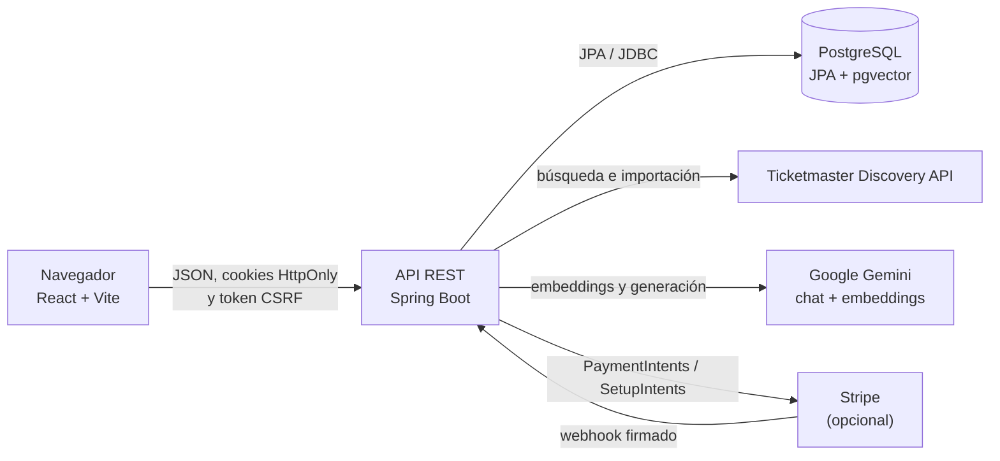
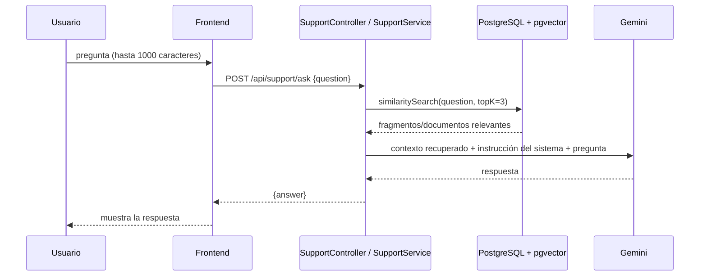

# Encore

Encore es una aplicación web para descubrir conciertos, reservar entradas y gestionar una cuenta de usuario. El repositorio contiene una SPA en React y una API REST en Java/Spring Boot, con PostgreSQL como persistencia. Integra Ticketmaster para importar eventos, Google Gemini y pgvector para responder consultas de soporte mediante recuperación de contexto, y Stripe como opción para pagos reales. Las compras pueden funcionar en modo demo sin cargos.

## Contenido

- [Arquitectura](#arquitectura)
- [Estructura del repositorio](#estructura-del-repositorio)
- [Flujos principales](#flujos-principales)
- [Integración de IA y búsqueda semántica](#integración-de-ia-y-búsqueda-semántica)
- [Frontend](#frontend)
- [Backend y persistencia](#backend-y-persistencia)
- [API REST](#api-rest)
- [Instalación y ejecución local](#instalación-y-ejecución-local)
- [Pruebas y build](#pruebas-y-build)
- [Configuración y seguridad](#configuración-y-seguridad)
- [Despliegue](#despliegue)
- [Limitaciones conocidas](#limitaciones-conocidas)

## Arquitectura



El navegador no se conecta directamente a PostgreSQL, Gemini ni Ticketmaster. Las credenciales privadas de esos servicios se configuran únicamente en el backend. La clave publicable de Stripe, cuando se habilitan pagos reales, es la única clave de Stripe que se entrega al frontend.

## Estructura del repositorio

```text
Encore/
├── backend/
│   ├── src/main/java/com/encore/encoreapi/
│   │   ├── admin/       # operaciones de administración
│   │   ├── config/      # roles y configuración de seguridad
│   │   ├── event/       # catálogo e integración con Ticketmaster
│   │   ├── payment/     # modo demo, Stripe y webhooks
│   │   ├── security/    # JWT, cookies, CSRF, TOTP y rate limit
│   │   ├── support/     # carga de conocimiento y RAG
│   │   ├── ticket/      # inventario, reservas y órdenes
│   │   └── user/        # cuentas, perfiles y errores REST
│   ├── src/main/resources/application.properties
│   ├── src/test/java/   # pruebas JUnit
│   ├── Dockerfile
│   ├── docker-compose.yml
│   ├── mvnw / mvnw.cmd
│   └── pom.xml
├── frontend/
│   ├── src/api.js       # cliente REST con cookies y CSRF
│   ├── src/components/  # páginas, formularios y componentes UI
│   ├── src/hooks/       # sesión, catálogo, búsqueda y consentimiento
│   ├── src/styles/
│   ├── vite.config.js
│   └── package.json
└── README.md
```

## Flujos principales

### Catálogo y compra

1. El frontend consulta el catálogo (`GET /api/events`) y los tipos de entrada de un evento.
2. El backend obtiene los eventos de PostgreSQL. La sincronización opcional importa conciertos desde Ticketmaster; Ticketmaster no proporciona el inventario vendible de Encore.
3. El navegador envía las cantidades seleccionadas y un UUID `idempotencyKey` al crear la orden.
4. El backend valida existencias y límites, y crea una reserva con expiración. La transacción y el control optimista protegen el inventario frente a peticiones concurrentes.
5. En modo demo se confirma sin crear un cargo. Con Stripe, el backend crea un PaymentIntent y confirma el pago verificándolo en el servidor; el webhook firmado también procesa `payment_intent.succeeded`.

Las reservas pendientes expiran a los 15 minutos y devuelven las unidades al inventario. Reutilizar la misma clave de idempotencia permite reintentar una petición de creación de orden sin duplicar la reserva.

### Sesión y llamadas protegidas

El login y el registro establecen una cookie de sesión JWT `HttpOnly`; el token no se guarda en `localStorage`. Para operaciones que modifican datos, el cliente obtiene primero un token CSRF en `/api/auth/csrf` y lo envía en `X-XSRF-TOKEN`. Las peticiones del frontend incluyen credenciales (`credentials: 'include'`).

### Asistente de soporte

El widget de chat envía una pregunta a `POST /api/support/ask`. El backend busca documentos de soporte relacionados en pgvector y pasa esos textos como contexto al modelo de chat Gemini. El diagrama del apartado de IA muestra el flujo de recuperación y generación.

## Integración de IA y búsqueda semántica

La IA implementada es un flujo RAG de soporte; **no** entrena ni hace fine-tuning de un modelo.

1. `KnowledgeBaseLoader` crea al arrancar cinco documentos de texto estáticos sobre Encore y los añade al `VectorStore`.
2. Spring AI genera embeddings con Google GenAI. La configuración del proyecto indica `gemini-embedding-001` y vectores de 768 dimensiones.
3. `SupportService` consulta el vector store mediante similitud coseno, solicitando los tres documentos más relevantes (`topK = 3`).
4. El texto recuperado se incluye en la instrucción del sistema del modelo de chat, configurado como `gemini-3.8-flash`; la pregunta se envía como mensaje del usuario.
5. La instrucción pide responder únicamente con ese contexto y declarar que no se dispone de la información si el contexto no permite contestar.



La configuración actual está en `backend/src/main/resources/application.properties`:

| Parámetro | Valor configurado |
|---|---|
| Modelo de chat | `gemini-3.8-flash` |
| Modelo de embeddings | `gemini-embedding-001` |
| Dimensiones | `768` |
| Búsqueda | distancia coseno, índice HNSW |
| Contexto recuperado por pregunta | Hasta 3 documentos |
| Clave del proveedor | `GEMINI_API_KEY` (backend) |

La tabla/esquema de pgvector se configura para inicializarse con Spring AI (`initialize-schema=true`). La base PostgreSQL debe tener disponible la extensión `vector`; la imagen de desarrollo usa `pgvector/pgvector:pg16`. No existe una pantalla o API de administración de la base de conocimiento ni un proceso de ingesta desde archivos externos: el contenido de partida está codificado en `KnowledgeBaseLoader`.

**Limitaciones de la implementación actual:** los cinco textos de ejemplo se añaden durante cada arranque, sin versionado ni mecanismo explícito de deduplicación; el contexto no incluye historial conversacional y el límite de recuperación está fijado en tres. Además, parte del texto semilla afirma que se verifica el correo y describe reembolsos en 24 horas, mientras que el flujo de registro actual no verifica correo y las reglas descritas no representan necesariamente la lógica de órdenes. Por tanto, ese contenido debe revisarse antes de presentarlo como política oficial. La recuperación puede limitar respuestas incorrectas, pero no garantiza que el modelo siempre siga las instrucciones.

## Frontend

- **Tecnologías:** React 19, JavaScript, Vite 6 y Stripe.js/React Stripe Elements.
- **Páginas SPA:** inicio/catálogo (`/`), perfil (`/perfil`), privacidad (`/privacidad`), términos (`/terminos`) y página no encontrada.
- **Componentes destacados:** cabecera y navegación, hero, catálogo y filtros, tarjetas de evento, diálogos de autenticación/evento/órdenes, perfil y medios de pago, checkout Stripe y chat de soporte.
- **Estado:** estado local de React y hooks propios (`useSession`, `useEvents`, `useHomePage`, `useDebouncedValue`, `useAnalyticsConsent`). La preferencia de tema se almacena localmente; no hay una biblioteca externa de estado global.
- **Navegación:** `AppRoutes` gestiona rutas con History API; no se usa una biblioteca de routing.
- **API:** `src/api.js` centraliza `fetch`, cookies, JSON, CSRF, errores HTTP y la renovación/repetición de una petición idempotente ante un token CSRF expirado.
- **Experiencia y privacidad:** búsqueda con debounce, interfaz adaptable, consentimiento de analítica antes de cargar GA4 y metadatos de página actualizados en cliente. Las rutas de la SPA deben reescribirse a `index.html` en el hosting estático.

Las variables `VITE_*` se incorporan al bundle público: nunca se deben usar para claves privadas ni secretos.

## Backend y persistencia

### Organización y responsabilidades

El backend usa Java 21, Spring Boot 4.1.1, Spring MVC, Spring Security, Spring Data JPA, Bean Validation y PostgreSQL. Spring AI conecta los modelos Google GenAI y el almacén pgvector; el SDK Java de Stripe implementa pagos. Las pruebas usan JUnit y Mockito.

- `event`: modelo y consultas del catálogo, cliente Ticketmaster, sincronización manual y automática.
- `ticket`: tipos/categorías, inventario, reservas, órdenes, expiración e idempotencia.
- `payment`: elección del modo demo/Stripe, PaymentIntents, SetupIntents, divisa y reembolsos.
- `user`: registro, login, perfil y ciclo de eliminación de cuenta.
- `security` y `config`: JWT, cookies, CSRF, roles, TOTP y limitación de peticiones.
- `support`: carga del conocimiento estático, recuperación vectorial y respuesta Gemini.
- `admin`: consultas y operaciones de usuarios, órdenes, inventario y estadísticas.

### Base de datos

PostgreSQL persiste usuarios, eventos, tipos de entrada, órdenes y líneas de orden mediante JPA/Hibernate. Hibernate usa `ddl-auto=update`; Flyway está desactivado y no hay migraciones SQL mantenidas en `src/main`. El almacén vectorial de Spring AI comparte PostgreSQL y requiere pgvector.

La sincronización de Ticketmaster crea/actualiza eventos, pero el inventario y los precios son propios de Encore. El catálogo de entradas registra capacidad, disponibilidad, reservas y ventas, junto con categoría y moneda. Los límites de compra por categoría son configurables mediante `TICKETS_NORMAL_PURCHASE_LIMIT` y `TICKETS_VIP_PURCHASE_LIMIT` (por defecto 10 `NORMAL` y 5 `VIP`).

### Validación, errores y protección

- Los cuerpos con restricciones usan Jakarta Bean Validation; los errores de validación y argumentos inválidos responden `400`.
- Los errores inesperados responden `500` con un mensaje genérico y se registran en backend. Un conflicto de bloqueo optimista responde `409`.
- Las rutas protegidas responden `401` si falta autenticación y `403` si el usuario no tiene permisos o falla CSRF. El límite de peticiones responde `429` e incluye `Retry-After`.
- Las contraseñas se codifican con BCrypt. JWT se transporta en cookie `HttpOnly`; CORS admite orígenes explícitos y credenciales, y CSRF protege peticiones mutables.
- Hay TOTP opcional para el acceso de dos factores y limitación en memoria por IP: 120 solicitudes por minuto para la API y 10 por minuto para soporte. El webhook de Stripe está excluido de ese filtro general. Estos contadores no se comparten entre instancias y usan `request.getRemoteAddr()`.
- Se puede solicitar la eliminación de cuenta y cancelarla dentro del periodo de gracia de 14 días; la tarea programada elimina cuentas vencidas.

## API REST

Todas las rutas llevan el prefijo `/api`. Los cuerpos y respuestas son JSON salvo indicación distinta. Los UUID de los ejemplos son ficticios. Las peticiones autenticadas necesitan la cookie de sesión; las mutaciones también necesitan CSRF, excepto el webhook de Stripe, que verifica la firma del proveedor.

| Método | Ruta | Finalidad y parámetros | Acceso |
|---|---|---|---|
| `POST` | `/auth/register` | Registro; cuerpo `email`, `password`, `name`. Crea sesión. | Público + CSRF |
| `POST` | `/auth/login` | Inicio de sesión; cuerpo `email`, `password`. Si requiere TOTP devuelve `requiresTotp: true`. | Público + CSRF |
| `POST` | `/auth/login/totp?code=...` | Completa login 2FA; cuerpo de credenciales y código TOTP como query param. | Público + CSRF |
| `GET` | `/auth/csrf` | Obtiene token CSRF. | Público |
| `GET` | `/auth/me` | Obtiene el perfil actual. | Usuario |
| `PATCH` | `/auth/me` | Actualiza perfil; cuerpo `{"name":"..."}`. | Usuario + CSRF |
| `DELETE` | `/auth/me` | Solicita eliminación de cuenta. | Usuario + CSRF |
| `POST` | `/auth/me/cancel-deletion` | Cancela la solicitud de eliminación. | Usuario + CSRF |
| `POST` | `/auth/totp/setup` | Inicia configuración TOTP; devuelve QR y secreto de configuración. | Usuario + CSRF |
| `POST` | `/auth/totp/confirm` | Confirma TOTP; cuerpo `{"code":"123456"}` (valor ilustrativo). | Usuario + CSRF |
| `POST` | `/auth/logout` | Cierra sesión y caduca la cookie. | CSRF |
| `GET` | `/events?city=Barcelona&search=texto` | Busca eventos; `city` y `search` opcionales. Omitir ciudad consulta todas. | Público |
| `GET` | `/events/cities` | Lista ciudades disponibles. | Público |
| `GET` | `/events/{id}` | Obtiene un evento por UUID. | Público |
| `POST` | `/events/sync?city=Madrid&countryCode=ES` | Sincroniza una ciudad con Ticketmaster; parámetros opcionales, por defecto Madrid y ES. | ADMIN + CSRF |
| `GET` | `/ticket-types/event/{eventId}` | Lista tipos de entrada del evento y cantidades. | Público |
| `POST` | `/ticket-types` | Crea inventario; cuerpo `eventId`, `name`, `price`, `quantity`, y opcionalmente `category`, `currency`. | ADMIN + CSRF |
| `PATCH` | `/ticket-types/{id}` | Modifica campos de un tipo: `name`, `price`, `currency`, `totalQuantity`, `availableQuantity`. | ADMIN + CSRF |
| `POST` | `/orders` | Crea una reserva; cuerpo documentado abajo. | Usuario + CSRF |
| `GET` | `/orders` | Lista las órdenes propias no ocultas del historial. | Usuario |
| `GET` | `/orders/{orderId}` | Consulta una orden propia. | Usuario |
| `DELETE` | `/orders/{orderId}` | Cancela una reserva pendiente o la oculta del historial según su estado. | Usuario + CSRF |
| `GET` | `/payments/mode` | Devuelve `{"demoMode":true|false}`. | Público |
| `POST` | `/payments/demo-confirm/{orderId}` | Confirma una compra sin cargo si el modo demo está activo. | Usuario + CSRF |
| `POST` | `/payments/create-intent/{orderId}` | Crea PaymentIntent y devuelve su `clientSecret` si Stripe está activo. | Usuario + CSRF |
| `POST` | `/payments/confirm/{orderId}` | Verifica un pago; cuerpo `{"paymentIntentId":"..."}`. | Usuario + CSRF |
| `GET` | `/payments/payment-method` | Consulta el medio de pago principal asociado en Stripe. | Usuario |
| `POST` | `/payments/setup-intent` | Inicia la configuración segura de medio de pago; devuelve `clientSecret`. | Usuario + CSRF |
| `POST` | `/payments/payment-method` | Guarda un SetupIntent confirmado; cuerpo `{"setupIntentId":"..."}`. | Usuario + CSRF |
| `POST` | `/payments/webhook` | Procesa eventos Stripe; requiere cabecera `Stripe-Signature` válida. | Stripe |
| `POST` | `/support/ask` | Consulta al asistente; cuerpo `{"question":"..."}`, no vacío y máximo 1000 caracteres. | Público |
| `GET` | `/admin/orders` | Lista órdenes. | ADMIN |
| `POST` | `/admin/orders/{id}/cancel` | Cancela una orden. | ADMIN + CSRF |
| `GET` | `/admin/users` | Lista usuarios. | ADMIN |
| `PATCH` | `/admin/users/{id}/role` | Cambia rol; cuerpo `{"role":"USER"}` o rol válido. | ADMIN + CSRF |
| `GET` | `/admin/stats` | Devuelve recuentos de usuarios/órdenes, órdenes pagadas e ingresos. | ADMIN |

Los prefijos de la tabla se concatenan con `/api` (por ejemplo, `/events` corresponde a `/api/events`). No hay paginación expuesta por estos controladores.

## Instalación y ejecución local

### Requisitos

- Java 21.
- Node.js y npm compatibles con el lockfile del frontend.
- Docker con Docker Compose para ejecutar PostgreSQL local (la imagen incluye pgvector).
- Una clave de Google GenAI válida para usar el asistente. Ticketmaster es necesario si se quieren importar eventos reales; Stripe solo si se quieren habilitar pagos reales.

### 1. Configurar variables locales

Los archivos `backend/.env.example` y `frontend/.env.example` son plantillas. Copiarlos a `.env` en cada directorio y editar las copias localmente; `.env` está excluido del control de versiones.

```powershell
Copy-Item backend\.env.example backend\.env
Copy-Item frontend\.env.example frontend\.env
```

En `frontend/.env`, usar `VITE_API_BASE_URL=/api` para desarrollo local. Vite reenvía `/api` a `http://localhost:8080`. No colocar secretos en variables `VITE_*`.

### 2. Iniciar base de datos y API

Desde la raíz del repositorio:

```powershell
Set-Location backend
docker compose up --build
```

Compose inicia PostgreSQL con pgvector en el puerto local `5433` y la API en `8080`; espera a que PostgreSQL pase su health check antes de iniciar la API. Compose carga `backend/.env` para interpolar las variables. Si se desea ejecutar la API directamente en el host en lugar de Docker, se puede iniciar solo PostgreSQL con `docker compose up -d postgres` y ejecutar `.\mvnw.cmd spring-boot:run`, pero hay que exportar/configurar las variables de backend en el entorno del proceso (Spring Boot no carga `.env` automáticamente).

La API escucha por defecto en `http://localhost:8080`; `GET http://localhost:8080/api/events/cities` sirve como comprobación sencilla.

### 3. Iniciar el frontend

En otra terminal desde la raíz:

```powershell
Set-Location frontend
npm ci
npm run dev
```

Abrir la URL local que imprime Vite (normalmente `http://localhost:5173`). Para acceder al perfil y a las funciones de compra, registrar una cuenta en la aplicación. El chat necesita que Gemini y pgvector estén configurados.

## Pruebas y build

Frontend, desde `frontend/`:

```powershell
npm test
npm run build
```

Backend, desde `backend/`:

```powershell
.\mvnw.cmd test
.\mvnw.cmd package
```

El test del frontend ejecuta `node --test src/api.test.js`; Maven ejecuta las pruebas JUnit del backend. `npm run build` genera los archivos estáticos en `frontend/dist`; `.\mvnw.cmd package` compila y empaqueta la aplicación Spring Boot.

## Configuración y seguridad

### Backend

| Variable | Uso |
|---|---|
| `SPRING_DATASOURCE_URL` | URL JDBC de PostgreSQL; para Supabase usar SSL según la URL del proveedor. |
| `DB_USER`, `DB_PASSWORD` | Usuario y contraseña de base de datos. |
| `JWT_SECRET` | Secreto de firma JWT; mantener privado y suficientemente aleatorio. |
| `GEMINI_API_KEY` | Clave de servidor para chat y embeddings Gemini. |
| `TICKETMASTER_API_KEY` | Clave de servidor de Ticketmaster Discovery. |
| `TICKETMASTER_SYNC_ENABLED` | Activa/desactiva sincronización automática al iniciar; por defecto `false`. |
| `TICKETMASTER_SYNC_CITIES` | Ciudades separadas por comas para la importación automática. |
| `STRIPE_API_KEY` | Clave privada Stripe; si no existe, el modo predeterminado es demo. |
| `STRIPE_WEBHOOK_SECRET` | Secreto de firma del webhook Stripe. |
| `PAYMENTS_DEMO_MODE` | `true` fuerza demo; `false` exige pagos Stripe; vacío selecciona según disponibilidad de clave Stripe. |
| `AUTH_COOKIE_SECURE`, `AUTH_COOKIE_SAME_SITE` | Política de cookies de sesión/CSRF. `SameSite=None` requiere Secure. |
| `CORS_ALLOWED_ORIGINS` | Orígenes de frontend permitidos, separados por coma; no usar `*` con credenciales. |
| `TICKETS_NORMAL_PURCHASE_LIMIT`, `TICKETS_VIP_PURCHASE_LIMIT` | Máximo de compra por categoría; valores predeterminados 10 y 5. |
| `PORT` | Puerto HTTP del proceso; predeterminado `8080`. |

### Frontend

| Variable | Uso |
|---|---|
| `VITE_API_BASE_URL` | URL base del API, incluyendo `/api`; por defecto `/api`. |
| `VITE_STRIPE_PUBLISHABLE_KEY` | Clave publicable usada por Stripe Elements (no es secreta). |
| `VITE_SITE_URL` | Dominio HTTPS canónico para sitemap y metadatos del build. |
| `VITE_GA4_MEASUREMENT_ID` | Identificador GA4; la analítica solo se activa tras el consentimiento correspondiente. |

No copiar claves privadas a ejemplos, commits, issues ni bundles frontend. Usar gestores de secretos o variables del entorno del proveedor en despliegues; restringir CORS al origen web exacto y servir frontend/API mediante HTTPS. Los ejemplos de este README usan identificadores sintéticos y marcadores, no datos de cuentas reales.

## Despliegue

El backend incluye `Dockerfile` y Compose para desarrollo. El frontend se publica como sitio estático desde `frontend/dist`; el backend como servicio HTTP desde el artefacto Spring Boot o su imagen Docker. PostgreSQL puede ser autogestionado o un servicio administrado compatible (por ejemplo, Supabase PostgreSQL). En ambos servicios de hosting, configurar las variables indicadas en el apartado anterior y mantener todos los secretos en la configuración privada del proveedor.

Para producción:

- Configurar `VITE_API_BASE_URL` con el origen HTTPS del backend y el sufijo `/api`; configurar `CORS_ALLOWED_ORIGINS` con el origen HTTPS del frontend.
- Configurar `AUTH_COOKIE_SECURE=true`. Si frontend y API son cross-site, revisar `AUTH_COOKIE_SAME_SITE=None` y las políticas de cookies de terceros del navegador; cuando sea posible, usar dominios bajo el mismo sitio registrable.
- Crear en Stripe el endpoint de webhook del backend `/api/payments/webhook` y configurar su secreto de firma como variable privada. El webhook implementado procesa `payment_intent.succeeded`.
- Configurar `GEMINI_API_KEY` y habilitar pgvector en PostgreSQL para el chat de soporte. Configurar Ticketmaster solo cuando se requiera catálogo real.
- Añadir las reglas SPA del proveedor para servir `index.html` al cargar directamente `/perfil`, `/privacidad` y `/terminos`.

## Limitaciones conocidas

- El backend no verifica correos durante el registro ni implementa recuperación de contraseña por email.
- Ticketmaster aporta metadatos de eventos, no entradas o existencias vendibles. Los resultados de sincronización dependen de la API y las cuotas del proveedor.
- La limitación de peticiones es por proceso, no distribuida; en despliegues con varias instancias se requiere un limitador compartido para aplicar una cuota global.
- La sincronización vectorial de soporte usa un conjunto estático pequeño y tiene las limitaciones de contenido descritas en [Integración de IA](#integración-de-ia-y-búsqueda-semántica).
- Hibernate actualiza el esquema automáticamente (`ddl-auto=update`); no hay un flujo de migraciones versionadas para cambios de esquema.
- La información legal del sitio debe revisarse y completarse con los datos y políticas reales del responsable antes de producción.
